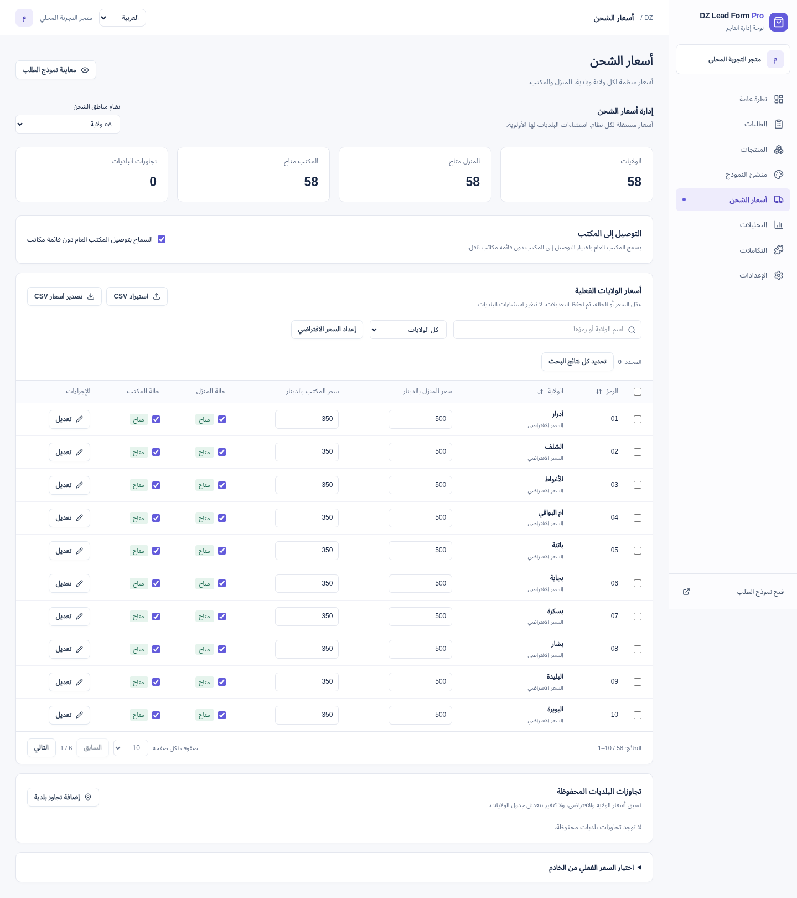

# DZ Lead Form Pro

تطبيق عربي RTL لطلبات الدفع عند الاستلام في الجزائر. يدعم حسابات تجار مستقلة، المنتجات والمخزون والشحن وتصميم النموذج والطلبات والتحليلات. [حالة التنفيذ والقيود](IMPLEMENTATION_STATUS.md) تفرق بين ما تم اختباره والتكاملات المتبقية.

## معاينة إعادة التصميم

اكتملت **المرحلة الأولى: التنقل والنظرة العامة ونظام الألوان المشترك**، و**المرحلة الثانية: جدول أسعار الشحن**. [تفاصيل المرحلة الأولى](docs/REDESIGN-STAGE-1.md) · [صفحة الشحن وطريقة تجربتها](docs/REDESIGN-STAGE-2.md). إعادة تصميم الطلبات والمنتجات والمنشئ ونموذج العميل تنتظر الموافقة على المرحلة التالية.

اللقطات من قواعد تجربة مؤقتة؛ الطلبات والأسعار الظاهرة للتجربة ولا تمثل إيرادات أو أسعار ناقل فعلي.



[الهاتف](docs/screenshots/stage2-shipping-mobile.png) · [نافذة تعديل القاعدة](docs/screenshots/stage2-shipping-editor.png) · [نافذة CSV](docs/screenshots/stage2-shipping-csv.png) · [الشحن بالفرنسية](docs/screenshots/stage2-shipping-fr.png) · [النظرة العامة](docs/screenshots/stage1-overview-desktop.png)

## تنزيل المشروع من GitHub على Windows

افتح [المستودع](https://github.com/zakkoussama1-wq/-)، ثم **Code → Download ZIP** واستخرج الملف كاملًا. افتح المجلد الذي يحتوي على `package.json` و`START-WINDOWS.cmd`. ثبّت **Node.js 24 LTS**، ثم شغّل `START-WINDOWS.cmd` وانتظر ظهور **Ready**. افتح `OPEN-FORM.cmd` للنموذج و`OPEN-DASHBOARD.cmd` للإدارة. لا تفتح node.exe ولا تكتب أوامر npm داخل نافذة Node التفاعلية.

عند التشغيل من CMD أو PowerShell داخل مجلد المشروع:

```bat
npm.cmd ci
npm.cmd run dev:local
```

بعد تشغيله على حاسوبك يعمل `http://localhost:3000/form` للنموذج و`http://localhost:3000/dashboard` للإدارة. دليل الخطوات وحلول أخطاء Windows في [WINDOWS-START-HERE.md](WINDOWS-START-HERE.md).

تشمل النسخة بيانات الولايات والبلديات في JSON ومرجع `data/geography.sqlite`، والمصادر والسكربتات التي تتحقق منها وتعيد بناءها. قواعد الحسابات والطلبات وبيانات العملاء وملفات الاعتمادات تبقى محليًا خارج Git؛ تنشئ التجربة قواعد SQLite مستقلة عند أول تشغيل. لا تحتاج استضافة أو Shopify للتجربة.

## التجربة المحلية المطلوبة الآن

**Windows:** اتبع [دليل التحميل والتشغيل](WINDOWS-START-HERE.md). بعد تثبيت Node.js 24 وفك ضغط المشروع، انقر START-WINDOWS.cmd ثم OPEN-FORM.cmd أو OPEN-DASHBOARD.cmd. روابط localhost تعمل بعد تشغيل النسخة على حاسوبك؛ لا تمثل رابطًا للبيئة السحابية.

النشر الخارجي وربط Shopify **متوقفان** بطلب المستخدم. احتُفظ بكل الملفات السابقة. لا تحتاج Render أو Railway أو دومين أو PostgreSQL أو أي حساب خارجي للتجربة.

Node.js 24 وnpm 11:

```sh
npm ci
npm run dev:local
```

يفتح الأمر خادم تطوير على المنفذ 3000. على جهاز التشغيل نفسه افتح مسار `/form` للنموذج و`/dashboard` للإدارة. يمكن فتح الإدارة من شريط النموذج، وفتح النموذج من قائمة الإدارة أو زر المعاينة. اختيار **العربية / Français / English** متاح أعلى الصفحات. إذا كانت أداة البيئة لا توفر معاينة أو تمرير منفذ فلن يعمل عنوان localhost الخاص بالخادم السحابي على جهازك؛ شغّل الأوامر نفسها على جهازك وافتح `http://localhost:3000` في متصفحك. لا يتوفر موصل معاينة في هذه الجلسة.

وضع `dev:local`:

- دخول مباشر للإدارة دون حساب في وضع التطوير فقط؛ لا يمنح الوصول عند NODE_ENV=production.
- SQLite مستقل تحت `data/local-demo/`؛ يعزل بيانات التجربة عن جميع قواعد البيانات السابقة ويحفظ التعديلات والطلبات بعد إعادة التشغيل.
- منتج DEMO بسعر ٣٩٠٠ دج، وأسعار أولية وهمية لجميع الولايات: ٥٠٠ دج للمنزل و٣٥٠ دج للمكتب العام. تُزرع أسعار التجربة أول مرة فقط، ولا تستبدل تعديلاتك عند التشغيل مجددًا.
- يتجاهل DATABASE_URL الموجود لهذا الأمر ويعطل مسارات ربط Shopify والتتبع الخارجي. لا يحذف اعتمادًا أو ملفًا محفوظًا.

### كيف ترسل طلبًا وتغير التوصيل؟

1. اضغط **فتح نموذج الطلب**. اختر الولاية ثم البلدية؛ أدخل اسمًا وهميًا ورقمًا مثل `0551234567`.
2. اختر **التوصيل إلى المنزل** وأدخل عنوانًا وهميًا مثل `شارع التجربة رقم 12`، ثم **تأكيد الطلب وحفظه**. ستظهر رسالة النجاح.
3. اضغط **فتح لوحة التحكم** ثم **الطلبات**؛ ستجد الاسم والتفاصيل والحالة والإجمالي المحفوظين. لا يحدث دفع أو إرسال خارجي.
4. من **أسعار الشحن** عدّل سعر الولاية أو حالتها داخل الجدول ثم **حفظ التعديلات**. لتغيير السعر الافتراضي لجميع الولايات التي ترثه اضغط **إعداد السعر الافتراضي**. لتطبيق قاعدة على جميع الولايات حتى التي تملك قاعدة خاصة، أزل البحث والتصفية ثم **تحديد كل نتائج البحث ← تعديل جماعي**. تبقى استثناءات البلديات محفوظة ولها الأولوية ثم الولاية ثم الافتراضي.
5. غيّر سعر المنزل والمكتب في الجدول ثم **حفظ التعديلات**، أو استخدم **حفظ القاعدة** داخل نافذة التعديل المتقدم. يتحدث النموذج المفتوح في تبويب آخر تلقائيًا؛ يعيد أيضًا جلب السعر عند العودة للتبويب. يؤكد الخادم السعر مجددًا عند الحفظ.
6. جرّب **التوصيل إلى المكتب**: يختفي عنوان المنزل ويتغير السعر. المكتب هنا عام للتجربة، ولا توجد قائمة ناقل أو مكاتب فعلية.
7. بدّل اللغة من الشريط العلوي؛ تُحفظ اللغة في المتصفح، وتصبح العربية RTL والفرنسية والإنجليزية LTR. تبقى أسماء المنتجات وحقول التاجر المخصصة كما أدخلها؛ تُترجم النصوص الافتراضية وحقول الواجهة ورسائلها، مع أسماء المناطق العربية واللاتينية.

أوامر التحقق: `npm run lint` و`npm run typecheck` و`npm test` و`npm run build`، ثم `PLAYWRIGHT_CHROMIUM_EXECUTABLE_PATH=/usr/bin/chromium npm run test:local`. اختبارات التجربة تستعمل ملفات مؤقتة مستقلة ولا تغيّر بيانات تجربتك. شغّل خوادم الفحص والبناء بالتتابع لتجنب إعادة توليد ملفات أنواع Next المشتركة أثناء اختبار المتصفح.

## منشئ النموذج والتصميم الجديد

من لوحة التحكم افتح **منشئ النموذج**. يتكون من أربعة تبويبات مع معاينة مباشرة للهاتف والحاسوب:

- **المحتوى:** العنوان والوصف ونص زر التأكيد ورسالة النجاح والنصوص والتلميحات، وتسميات الولاية والبلدية والتوصيل والقوائم وملخص الأسعار، واختيار المنتج والخيار المعروضين.
- **الحقول:** إظهار أو إخفاء قوائم المنتج والخيار والصورة والسعر والعنوان والوصف والشريط والملخص والكمية والبحث والتقسيم الإداري؛ وترتيب الحقول للأعلى والأسفل. للاسم والهاتف والعنوان ثلاثة أوضاع: إلزامي، اختياري أو مخفي. لا تُحفظ بيانات حقل مخفي؛ غياب الهاتف يعني أن الطلب سيُحفظ دون رقم اتصال.
- **التصميم:** أزرار أحمر وأصفر وأخضر وأزرق وبرتقالي، ولون مخصص وخلفية ولون نص، وعرض مختصر أو متباعد وتوزيع الحقول في عمود أو عمودين. يتغير لون كتابة الزر تلقائيًا للحفاظ على وضوحه مع الأصفر والبرتقالي.
- **التوصيل:** المنزل والمكتب لاختيار العميل أو طريقة واحدة فقط، واختيار افتراضي اختياري ونظام ٥٨/٦٩ ولاية. لا يوجد اختيار تلقائي في النموذج الافتراضي؛ يختار العميل الطريقة بعد تحديد المنطقة.

اضغط **حفظ النموذج** لتطبيق التصميم على النموذج العام. المعاينة داخل المنشئ لا ترسل طلبات. زر **معاينة نموذج الطلب** أعلى لوحة التحكم يفتح نافذة معاينة، بدل تكرار النموذج تحت كل شاشة إدارية.

النموذج الافتراضي مختصر: يخفي قائمتي المنتج والخيار والبحثين المنفصلين واختيار التقسيم الإداري والشروحات الطويلة، ويضع الاسم والهاتف جنبًا إلى جنب والولاية والبلدية جنبًا إلى جنب. يمكنك إعادة أي جزء من المنشئ.

اختيار المنزل أو المكتب يخضع أيضًا لسعر شحن مفعّل للمنطقة؛ فعّل المكتب وحدد سعره من **أسعار الشحن**. إخفاء اختيار التوصيل يتطلب تحديد طريقة واحدة. إخفاء الولاية والبلدية يتطلب اختيار منطقة ثابتة صحيحة في تبويب التوصيل لحساب الشحن؛ إخفاء الكمية يثبتها على قطعة واحدة. تُفرض هذه السياسات على الخادم كذلك.

الولاية والبلدية تحددان سعر الشحن وليستا حقول بحث إلزامية إضافية. المرجع الجغرافي نُقل إلى **الإعدادات ← مرجع الولايات والبلديات**. تعرض النظرة العامة بطاقات أعداد وقيم حقيقية وتقارير منظمة وحالة فارغة واضحة عند عدم وجود طلبات. أدوات CSV منفصلة للاستيراد والتصدير دون تغيير قواعد التحقق الذري أو أولوية الأسعار.

### صور الواجهات

صورتا لوحة التحكم والشحن تعرضان المرحلتين الجديدتين. صور المنشئ والنموذج محفوظة من المرحلة السابقة؛ تجديد تصميمهما ينتظر الموافقة. جميع الصور من التطبيق ببيانات تجربة وهمية:

| لوحة التحكم                                                | منشئ النموذج                                    | النموذج على الهاتف                                     | أدوات الشحن وCSV                                           |
| ---------------------------------------------------------- | ----------------------------------------------- | ------------------------------------------------------ | ---------------------------------------------------------- |
| [عرض الصورة](docs/screenshots/stage1-overview-desktop.png) | [عرض الصورة](docs/screenshots/form-builder.png) | [عرض الصورة](docs/screenshots/compact-form-mobile.png) | [عرض الصورة](docs/screenshots/stage2-shipping-desktop.png) |

## التشغيل المعتاد بحسابات مستقلة (اختياري)

Node.js 24 وnpm 11؛ استخدم نسخة المستودع الحالية، دون إنشاء worktree إضافي.

```sh
npm ci
npm run dev
```

أنشئ حساب تاجر من `/login` بالبريد واسم المتجر وكلمة مرور لا تقل عن ١٢ حرفًا. الإدارة `/dashboard`؛ انسخ رابط `/form?store=...` الخاص بحسابك من اللوحة لمشاركته. أضف منتجاتك وأسعار الشحن، وأرشف منتج DEMO عند الاستغناء عنه. لا توجد أسعار شحن افتراضية مختلقة. يبقى دخول المالك القديم دون بريد متاحًا للبيانات السابقة.

### PostgreSQL

دون `DATABASE_URL` تستخدم بيانات الأعمال SQLite داخل `data/`. عند تعيينه تنتقل جميع وحدات الأعمال إلى قاعدة PostgreSQL مشتركة؛ يبقى المرجع الجغرافي SQLite للقراءة. الاتصال بقاعدة بعيدة يتطلب TLS مع التحقق من الشهادة. لا تضع كلمة المرور في Git أو المحادثة.

لبيئة التطوير هذه، مع Docker محلي يعمل:

```sh
npm run postgres:dev
node scripts/with-postgres.mjs npm run dev
```

ينشئ أمر الخدمة PostgreSQL 17 على loopback:55432 وvolume باسم `dz-lead-postgres-data`، ويحتفظ باعتمادات محلية مولدة في `data/postgres-dev.env` بصلاحية 600 ومتجاهلة في Git. لا تحذف الملف أو volume. لا تشغّل نسختين من التطبيق على نفس المنفذ.

لترحيل SQLite مرة واحدة: أوقف الكتابة، انسخ SQLite احتياطيًا، ثم استخدم **هدف PostgreSQL فارغًا**:

```sh
node scripts/backup.mjs /ABS/NEW/sqlite-backup
node scripts/with-postgres.mjs npm run db:migrate-postgres
```

يرفض الترحيل الهدف الذي يحتوي بيانات ويتحقق من أعداد الصفوف داخل معاملة واحدة؛ لا يحذف ملفات المصدر. لا تعِد الترحيل عند كل تشغيل. تم تنفيذ ترحيل هذه البيئة بالفعل.

## وظائف التطبيق

- حسابات مستقلة بجلسات خادمية مجزأة وscrypt وخروج؛ تحدد الجلسة التاجر في العمليات الخاصة. رابط المتجر العام يختار بياناته العامة فقط.
- إنشاء وتعديل وأرشفة المنتجات وصور HTTPS وخياراتها وأسعارها بالسنتيم وكمياتها؛ الكمية الفارغة تعني عدم تتبع المخزون. لا يمكن حذف خيار قد تستند إليه طلبات محفوظة.
- شحن حسب البلدية ثم الولاية ثم الافتراضي، مع تعطيل الطرق، التوصيل المجاني، التعديل الجماعي وCSV. توصيل المكتب العام يحتاج تفعيلًا صريحًا؛ لا ندعي وجود قائمة مكاتب ناقل.
- تسعير خادمي وخصم ثابت أو نسبي، رفض السعر القديم، تطبيع الهاتف الجزائري، تحقق العنوان حسب الطريقة، ومنع الإرسال المكرر بمفتاح idempotency.
- حفظ الطلب وحجز المخزون في معاملة واحدة مع قراءة السعر والشحن داخلها على SQLite وPostgreSQL. يعيد الإلغاء المخزون المحجوز مرة واحدة؛ الحالات المكتملة والملغاة نهائية.
- إدارة الطلبات والبحث والتصفية حسب الحالة واليوم UTC والتفاصيل وCSV. تحليلات من الطلبات الفعلية؛ قيمة الطلبات لا تعني إيرادًا محصلًا.
- تخصيص النصوص والألوان والأجزاء المرئية وترتيب مجموعات الحقول في DOM ولوحة المفاتيح، مع سياسات إلزامي/اختياري/مخفي تُطبّق على الخادم.
- ٥٨/٦٩ ولاية و١٥٤١ بلدية مع البحث بالعربية والفرنسية. وضع ٦٩ يحمل تنبيه أن المطابقة المباشرة بالمرجع الرسمي ما زالت معلقة؛ [المصادر](data/geography/README.md).

مسار `/api/checkout/validate` تحقق فقط؛ الحفظ الفعلي عبر `/api/orders`. التأكيد لا يحصّل دفعة ولا يرسل أحداث تتبع تلقائيًا.

## Shopify والتتبع

المتجر الذي حدده المستخدم: `leadformarab.myshopify.com`. راجع `.env.example` وأدخل القيم عبر إعدادات الخادم الآمنة: `SHOPIFY_SHOP`، `SHOPIFY_CLIENT_ID`، `SHOPIFY_CLIENT_SECRET`، `SHOPIFY_REDIRECT_URI`، `INTEGRATIONS_ENCRYPTION_KEY` (٣٢ بايت عشوائية ممثلة بـ٦٤ رمز hex). احتفظ بمفتاح التشفير خارج النسخة الاحتياطية أيضًا.

URL العودة المسجل في إعدادات تطبيق Shopify يجب أن يطابق `https://YOUR_APP_DOMAIN/api/integrations/shopify/callback`. بدء التفويض من قسم التكاملات؛ state صالح مرة واحدة ومربوط بالتاجر والمتجر، callback يفحص HMAC والوقت، والرمز المخزن مشفر AES-256-GCM. الصلاحية الحالية `read_products` فقط. **لا توجد مزامنة منتجات Shopify أو إنشاء طلب Shopify أو webhooks مسجلة أو فوترة اشتراكات بعد.** لم يتم تفويض المتجر أو اختباره حيًا.

توجد محولات HTTP لأحداث اختبار Meta Lead وTikTok SubmitForm في وحدة التكاملات، مع اشتراط الموافقة وtestMode وtestEventCode وإخفاء الرمز من الأخطاء. لم تُربط بإعدادات حساب التاجر أو إرسال تلقائي، ولم تُرسل أحداث فعلية.

## النسخ الاحتياطي

تحتوي قواعد الأعمال والنسخ على بيانات العملاء؛ احمها خارج الخادم مع سياسة احتفاظ وصلاحيات مناسبة. إعادة بذر الجغرافيا لا تلمس قواعد الأعمال.

SQLite: أوقف الكتابة، استخدم `scripts/backup.mjs NEW_DIRECTORY` ثم `scripts/restore.mjs BACKUP_DIRECTORY NEW_TARGET_DIRECTORY`. يتحقق الاسترجاع من SHA-256 وسلامة SQLite ويرفض الاستبدال. ملفات الأعمال: `auth.sqlite` و`checkout.sqlite` و`shipping.sqlite` و`orders.sqlite`. متغيرات المسار البديلة: `AUTH_DATABASE_PATH` و`CHECKOUT_DATABASE_PATH` و`SHIPPING_DATABASE_PATH` و`ORDERS_DATABASE_PATH`، والجغرافيا `GEOGRAPHY_DATABASE_PATH`.

PostgreSQL المحلي في Docker:

```sh
node scripts/postgres-backup.mjs /ABS/NEW/backup.dump
node scripts/postgres-restore.mjs /ABS/NEW/backup.dump dz_restore_NEW_NAME
```

يستخدم pg_dump بتنسيق custom وصلاحية 600 وmanifest SHA-256، ويسترجع داخل قاعدة **جديدة** فقط. تم التحقق من الاسترجاع ومطابقة أعداد جميع الجداول. لقاعدة مُدارة استخدم نسخ مزود الخدمة وpg_dump/pg_restore المطابقين للإصدار، واختبر الاستعادة قبل الإطلاق؛ هذان السكربتان يخصان حاوية التطوير المحلية. نسخ SQLite لا تنسخ بيانات PostgreSQL.

## البناء والنشر

```sh
npm run build
node scripts/with-postgres.mjs npm start
```

يوفر `Dockerfile` بناء standalone متعدد المراحل ومستخدم node غير root وفحص `/api/health`. افحص `.env.example`، ومرّر القيم الآمنة وقت التشغيل مع PostgreSQL دائم وHTTPS. لا تحتوي الصورة على قواعد أعمال التطوير أو مفاتيحها. يتضمن `/api/health` استعلام قاعدة بيانات ولا يعرض تفاصيل الاتصال.

في البيئة السحابية الحالية، حافظ على proxy والتحقق TLS وشهادة البيئة:

```sh
docker --host=unix:///var/run/docker.sock build \
  --secret id=proxy_ca,src="$CODEX_PROXY_CERT" -t dz-lead-form-pro:local .
```

على استضافة عادية يمكن بناء الصورة دون هذا السر باستخدام جذور TLS النظامية. إذا كان التشغيل نفسه يستخدم proxy بشهادة خاصة، اربط شهادة CA للقراءة فقط واضبط `NODE_EXTRA_CA_CERTS`؛ لا تنسخ شهادة الجلسة داخل الصورة. PostgreSQL البعيد يحتاج عنوانًا يمكن للحاوية الوصول إليه وشهادة صالحة، لا تستخدم عنوان loopback لقاعدة خارج الحاوية. لم يحدث نشر عام أو ضبط DNS/HTTPS. وجهة النشر المختارة Render؛ راجع [دليل النشر](RENDER_DEPLOYMENT.md) و[Blueprint](render.yaml).

## التحقق

```sh
npm run lint
npm run typecheck
npm run format:check
npm test
npm run postgres:dev
npm run test:postgres
npm run build
node scripts/with-postgres.mjs node scripts/smoke-postgres.mjs
PLAYWRIGHT_CHROMIUM_EXECUTABLE_PATH=/usr/bin/chromium npm run test:e2e
npm audit
```

اختبارات المتصفح تحتاج منفذ 3000 خاليًا، وتستخدم قواعد اختبار منفصلة وتجاوز مصادقة لا يعمل في الإنتاج. يتخطى الاختبار الافتراضي مجموعة PostgreSQL ذات الأربع حالات عند غياب POSTGRES_TEST_URL؛ أمر test:postgres يشغلها على خدمة حقيقية داخل schema معزول. فحص HTTP للإنتاج ينشئ حسابات اختبار في schema مؤقتة ويحذفها بعد التحقق من العزل والتسعير والحفظ المتزامن والخروج. لا تستخدم اختبارات البيانات على قاعدة الإنتاج.

أضيف workflow لـGitHub Actions يجمع هذه الفحوص بخدمة PostgreSQL مؤقتة؛ لم يتم تشغيله على GitHub في هذه الجلسة. لا توجد Prisma في التنفيذ الحالي؛ يستخدم pg وnode:sqlite. يلزم قبل التشغيل التجاري استكمال تكاملات Shopify، استرجاع الحسابات والتحقق من البريد والأدوار وسياسة الاحتفاظ ومراقبة التشغيل ومراجعة أمان مستقلة.
